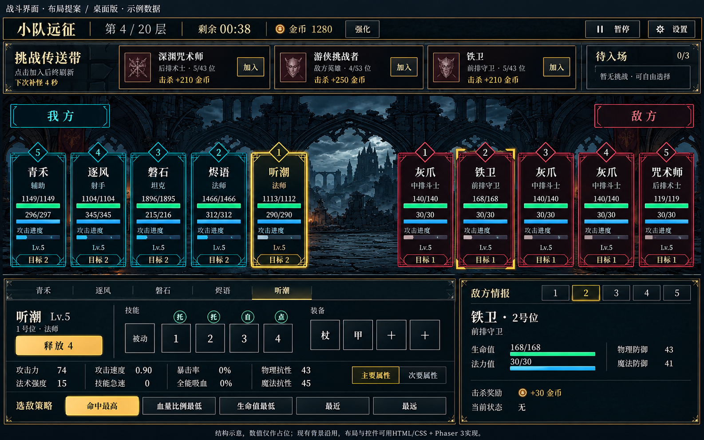

# 战斗页可实施布局提案

2026-10-20（北京时间），R055。用户要求“出示意图并且要是AI能实现的”。本轮用已读取的frontend-design技能规划，再以R052真实截图为参考生成布局图。**这是生成的设计示意，不是代码运行截图，也没有批准实施。**

## 实施对应

| 图中区域 | 现有实现基础 | 接入方式 |
| --- | --- | --- |
| 顶部层数/计时/金币/暂停 | src/app.js 的战斗HUD与当前状态 | DOM/CSS Grid调整间距和字号，沿用数据与事件 |
| 挑战传送带与队列 | 已有挑战、排队、刷新逻辑 | DOM紧凑卡片排版，保留加入与说明入口 |
| 五对五、资源条和目标号 | PhaserBattleRenderer的单位卡与血蓝/进度 | 调整布局坐标、边框强弱和文字层级，复用现有背景资源 |
| 英雄技能/装备/四组属性 | 现有底栏DOM与主要/次要属性 | CSS Grid/Flex重新分配宽度，保留既有真实数据 |
| 模式圆钮、独立释放4 | 已有逐技能三模式和手动释放 | 保留说明/模式/释放三种独立命中区，待放/CD/缺蓝沿现有状态 |
| 右下敌人详情 | 现有选敌与槽位详情 | 信息分组及选中样式；查看敌人与设置攻击偏好仍区分 |

桌面参考1440×900：顶栏约50px、传送带约100px、战场约380–440px，其余给底栏和间距；底栏约2:1两列。用可调Grid和最小尺寸约束，不能将这些估算直接硬编码后宣称所有屏幕适配。2560×1440需限制文字/控件过度放大；740×360手机继续独立规划，本图不证明手机布局已经解决。

## 图像与真正实现的差别

- 图中主要/次要被生成成两个按钮；实施继续沿D018保留**单按钮切换、面板等高**。
- 图中技能没有完整画出CD、缺蓝、待放等全部状态；实际实现必须保留真实技能状态与等级，不能为了干净删除。
- 金币、血蓝、抗性与奖励均为占位，不是平衡建议；图中铁卫在挑战卡和详情中的不同奖励不可直接照抄，运行时分别取真实实例数据。
- 生成图把背景重新描绘，实际代码应直接沿用仓库原背景，不用此整图替换游戏画布。挑战小徽记非必需美术，可用现有文字占位或简单SVG。
- 金色角标表达目标关系，但查看对象与玩家指定攻击偏好是两种状态；实现时不能把查看敌人自动变成发指令。
- 新增/加强高亮属于表现调整，沿既有状态即可实现；不新增装备槽、技能、数值计算、施法规则或战斗动画结算。

## 确定方案后的验收

先在1440×900接一个桌面布局，再检查2560×1440；检查五英雄五敌位、敌人死亡留空、多个手动技能按钮、长名称与说明浮窗。保留暂停原因叠加、技能模式切换不释放、查看和指令分离、主要/次要等高切换。最后提交真实浏览器前后截图。该阶段尚未开始，本次没有运行游戏回归或性能测试。
