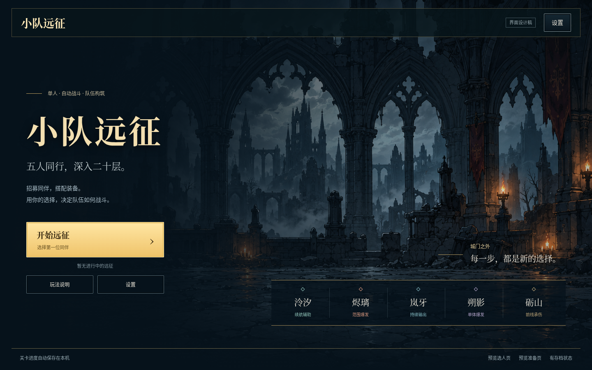
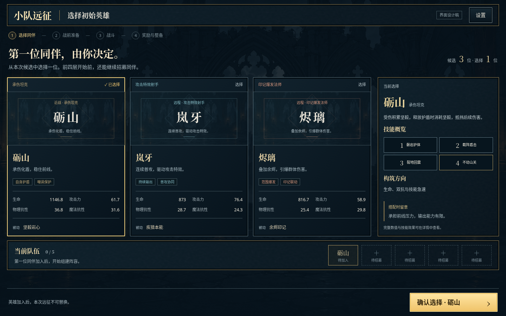
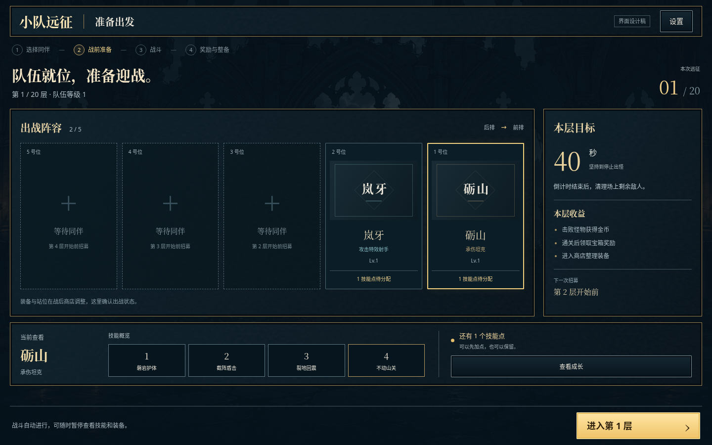

# R067 · 首页、英雄选择、战前准备设计稿

2026-10-20，北京时间。用户要求“开始设计，保持风格一致”，并寻找之前的首页图片。本轮是独立HTML/CSS视觉方案，未接入游戏首页、招募或准备流程；没有修改src、存档或英雄逻辑。结合R061商店/宝箱实图，使用frontend-design与Playwright技能设计、运行并检查。

## 找到的历史线索

- 仓库PROGRESS历史H12记有“首页参考土豆兄弟”，同时注明早期设计图没有纳入Git。对当前文件及全部可见Git历史的图片路径进行了检索，保存的概念图主要是战斗与商店；没有找到独立首页概念图文件。
- 在原聊天“设置 MG”（thread `01a13e86-7b17-75a7-b378-51297d5a5032`）找到用户要求“先搭建框架，把主页那些界面做好，类似土豆兄弟，头像用框包文字占着”的原轮次 `01a13f26-8000-724d-89b0-bd70ee32a7f3`。助手交付过真实首页截图，工具记录路径为`/workspace/MYGAME/test-results/home-1440.png`与`home-2k.png`；原文件当前不可用，也不在Git历史中。
- 找到了上述交付记录，不等于恢复了原图片。下方[修改前首页](before-home.png)是本轮从b70a4c1运行源码重新截取，仍是旧橄榄绿、扇形文字卡布局；不是冒充当年原图。
- R061只接入战斗、商店、宝箱；首页/初选/准备确实仍用旧样式。当前检索无法证明其它未访问聊天中从未存在过首页概念图。

## 统一的视觉规则

| 项目 | 方案 |
| --- | --- |
| 主底色 | 深蓝黑 `#06121b`，继承远征主题 |
| 面板 | 蓝灰 `#0d202b`、弱铁纹，正文下方保持不透明度 |
| 主文字 | 象牙白 `#ece7da` |
| 次文字 | 灰蓝 `#acb9be`，维持正文对比度 |
| 选择/主操作 | 暖金 `#ebc36e`，仅用于当前选择、关键按钮与少量边线 |
| 结构线 | 灰蓝 `#43565e`，不让每个普通组件都抢金色重点 |
| 字体 | 复用Expedition Serif标题；正文/数值使用系统无衬线；中文缺字使用Noto CJK回退 |
| 图像 | 复用现有gothic-courtyard庭院与iron-grain铁纹；没有新增外部资源或角色插画 |

首页把远征场景作为主要视觉，操作集中左侧；选人/准备把场景压暗，让信息面板成为主角。保留角色姓名占位，但缩小重复空框，完整名称不截成单字。角色色只辅助区分，金色明确表示选择。这里预览五正式英雄的已接受设计内容，实际英雄代码由R066窗口负责。

## 首页

- 主操作在固定区域：无存档时“开始远征”；有有效存档时“继续远征”变为金色主按钮，“开始新的远征”为次按钮。
- 背景与战斗页同一个世界，正文区域叠加深色遮罩；五位英雄以紧凑姓名条提示队伍构筑，不再用巨大单字扇形卡撑满右侧。
- 玩法说明和设置保持容易找到；预览页链接是设计稿导航，正式接入时回归已有“浏览界面”次级入口。
- [有存档状态](home-saved.png)、[手机首页](home-phone.png)。有存档样例的层数/等级仅用于展示，不读取或模拟用户真实存档。

## 英雄选择／招募

- 左侧三个候选并排，显示完整姓名、定位、两个特点和四个比较字段；选中卡金边＋文字勾选，不只依赖颜色。
- 右侧随选择更新：机制说明、四技能名称、构筑方向和需要队友补足的短板，减少来回打开弹窗。
- 下方显示当前队伍及待加入候选；确认按钮在1440×900首屏可见。手机卡片纵向排列，底部操作条固定可见。
- 初始与后续招募复用组件，正式接入须按当前模型读取候选数量、已招募成员和阶段文案；不能把这张三候选样例硬编码成固定三人名单。R066五英雄迁移与不足三候选的规则由该窗口定义。
- 设计稿点卡可改变选择和详情；确认仅解释接入点。真实流程仍为“初始选择 → 第1层招募 → 战前准备”，没有省去第二次选人。

## 战前准备

- 首层示例采用两人出战、三个后续招募位，固定从左到右5→1，清楚说明空位何时补齐；满编后同一排显示五位，不在准备页加入拖换站位。
- 右侧简报显示当前模型已有的40秒出怪窗口、清场要求、击杀金币和通关宝箱，不编造无法提前知道的敌方阵容或奖励数值。
- 下方显示所选英雄的技能概览、成长入口和未用技能点；允许保留点数，不强制加点才能出发。
- 进入战斗仍为一个按钮，正式接入调用现有start-battle；当前设计稿只弹出说明，不启动假战斗。

## 能否实现及接入边界

这些图是浏览器直接渲染本目录HTML/CSS后的截图。标题、按钮、卡片、详情和布局都已有可复用代码；背景和字体已经在仓库中。实际接入主要工作是把当前静态展示数据替换成游戏模型，不需要用一张大图盖住交互。

| 设计内容 | 后续接入点 |
| --- | --- |
| 首页主次按钮/存档状态 | app.js renderHome、现有saved/new/continue；开始新局沿用原存档确认规则 |
| 候选卡及详情 | renderRecruit/recruitCards、selectedHero；英雄名称/技能/数值来自最终HEROES与技能目录 |
| 五位阵容/成长/目标简报 | renderReady、run.party/level/floor、RULES、growthButton |
| 统一外观 | 建议独立entry-ui.css，限定home/recruit/ready，避免覆盖R061商店或战斗HUD |
| 交互与可访问性 | 保留按钮语义、键盘焦点、选择状态；实际详情完整内容与触屏方式沿用已有体系 |

本原型不导入游戏代码、不读写localStorage；“设置”“成长”“出发”是明确标注的接入示意。未新增英雄/装备/资源/关卡规则。正式接入时需要与R066英雄/成长展示范围协调，并测试真实新局/续玩、初选和各轮招募、加点、开始战斗、返回首页及设置。

## 本地预览与验证

在仓库根目录运行`npm run dev`，打开开发服务的`/docs/design/ui-entry-proposal/index.html`；`?screen=recruit`和`?screen=ready`可直接切页，`?screen=home&saved=1`查看有存档布局。

复现截图：`node docs/design/ui-entry-proposal/capture.mjs`。在1440×900、2560×1440、390×844检查三页及有存档首页，共12个截图状态，全部无pageerror和横向溢出；验证候选/英雄切换、详情联动、原生对话框关闭，以及没有创建游戏存档。

[布局报告](layout-report.json)记录三页尺寸。桌面三页均一屏显示；确认/出发按钮底边分别在888px、1416px以内。手机首页844px，选人/准备允许纵向滚动，固定按钮在834px以内。首次截图发现1440桌面两页超高约96px/51px，已收紧间距并加入主按钮首屏断言后重跑通过。截图已目视检查；桌面无头浏览器和模拟触屏不代表真机性能。

本轮仅设计产物，不运行全游戏回归、不部署。来源基线b70a4c1，认领7601206；方案、截图和进度记录随R067提交同步，Page待同步。下一步按用户对设计的反馈决定接入或调整，不能把本目录的截图当成正式游戏已经更新。
