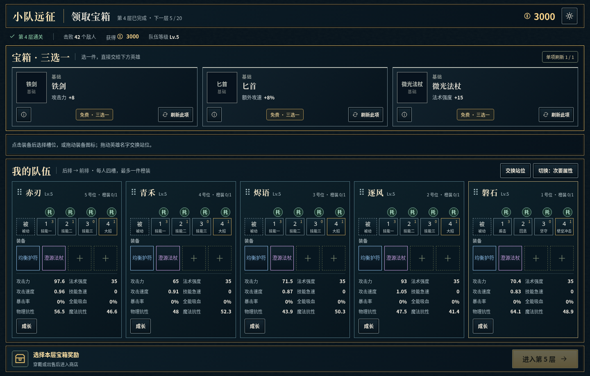
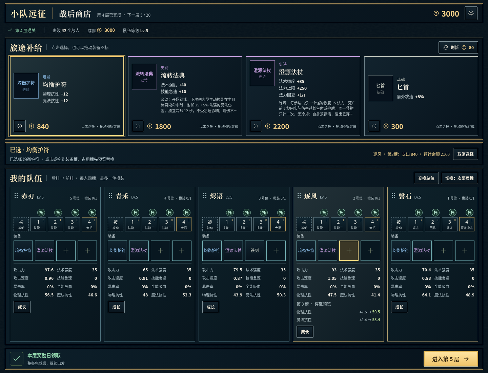
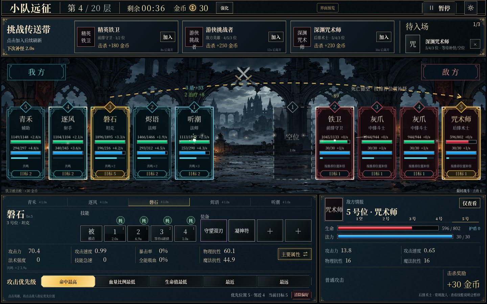

# R061 · 战斗、商店、宝箱运行实图

2026-10-20，北京时间。对应[D032](../../decisions/D032-unified-expedition-ui.md)与[进度R061](../../PROGRESS.md#r061)：在7e5fb8d基线上应用本目录所在提交的UI修改（包含R059基础弹道修复）。以下均由本地真实浏览器运行源码截图，不是生成示意图，也不是公网部署证据。

商店/宝箱使用测试脚本建立的真实模型存档：第4层、五位当前运行英雄、固定装备及3000金币，用于复现全名、替换与购买预览；这些不是新默认值或已打通关的玩家存档。战斗使用现有视觉测试夹具，英雄与装备仍读取游戏模型。

## 宝箱：同一主题的三选一

完整装备名、免费三选一、单项刷新与队伍同屏；尚未领取时下一层禁用。穿戴或出售后切换到商店。

## 商店：装备全名与实际属性预览

指向逐风第3个空槽，显示均衡护符的双抗变化及3000−840＝2160金币预估。选择/预览不写存档、不扣款。商品、槽位与详情显示全名，保持原品级颜色；占用槽继续局部确认，见[替换实图](replace-desktop.png)。

1440×900以可读性为先；长被动与预览可令整页高于900px。2560×1440与390×844也已验证，无横向溢出；[手机商店实图](shop-phone.png)采用纵向商品/英雄排列，允许长页面滚动，选择条吸顶。手机验证为Chromium触屏模拟，不等于真机性能结果。

## 战斗：同风格、完整装备名

保留现有场景背景，紧凑挑战条并扩大英雄详情相对宽度；装备全名可换行，主要/次要属性仍单按钮、等高切换，技能模式与释放行为不变。

## 验证与复现

- `npm run build`、`npm test`：构建及117项逻辑通过；保留既有Phaser大包提示。
- `node scripts/ui-theme-check.mjs`：1440×900、2560×1440、390×844；完整装备名/名称边界、数值预览边界、只读预览、宝箱阻止跳层/免费穿戴/切换商店、真实扣款、替换取消与保存恢复、主题作用范围通过。输出`test-results/ui-theme/`。
- `npm run test:shop`：桌面鼠标、手机CDP触屏拖放、替换/交换/出售/无效目标/持久化通过。
- `node scripts/equipment-interaction-check.mjs`：桌面/手机装备详情、三材料合成、材料不足、恢复与视口通过。
- `npm run test:battle`：桌面/触屏说明、暂停、技能释放、盾/吸血颜色、五策略/位置指令、挑战队列、存档与四尺寸视觉全部通过。输出`test-results/battle-visual/`，底栏占高约34.6%/35.3%/44.6%/48.3%（2560/1440/844/740宽）。

首次战斗套件运行被合入R059引起的开发服务器刷新打断；冻结代码后完整重跑通过。最终图已目视检查；本轮未部署，未改数值/配方/技能规则，Page待同步。
