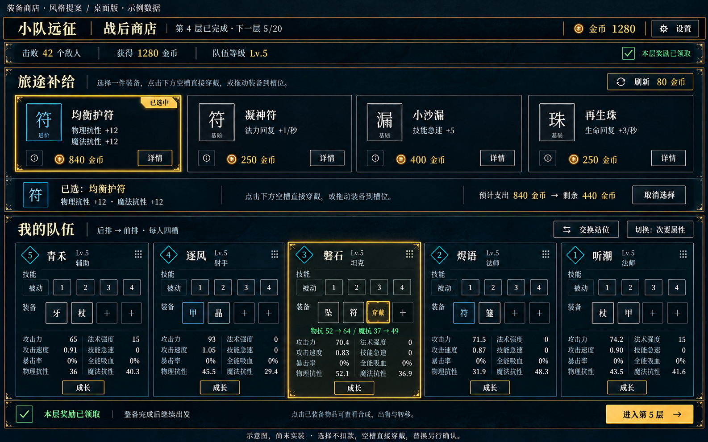

# 装备商店 · 同风格桌面示意

2026-10-20（北京时间），R057。用户对R055战斗图回复“可以”，要求装备商店也按这个风格出一版。本轮继续**设计示意**，没有游戏UI实施或上线。

参考图分别为[R055战斗风格](../ui-battle-proposal/desktop-concept.png)与[R052真实商店](../ui-audit-20261020/desktop-shop.png)。沿用frontend-design方法，生成图采用暗蓝底、象牙白文字、细金边、金色选择和青色槽位提示。不是最新运行截图，商品/属性/通关统计只用于说明布局。

## 布局与现有实现映射

- 顶部层数、金币、设置、通关摘要；沿用app.js的topbar/shop-summary。
- 上方四件商品：名称、品质、效果、售价和详情。商品选择只切换状态，依然支持拖动。
- 中间选择条：选中物品、操作提示、预计支出和预计余额、取消选择。用已有shopSelection/model预览数据实现，不提前扣款。
- 下方五英雄按5→1位置排列，每人保留四装备槽；目标槽高亮，在其英雄卡内预览真实属性变化。
- 选中商品后点空槽直接购买穿戴；占用槽保留既有局部替换确认。不新增购物车、仓库、锁定商品或统一购买确认步骤。
- 已穿戴装备保留合成、出售、转移入口与局部浮窗；图中没有把这些浮窗同时打开，不表示删功能。
- 页脚已领取状态＋下一层。宝箱阶段仍复用同页，上方切三选一，未领取时下一层不可用。

布局可以用现有DOM配合CSS Grid/Flex实现；商品四列、队伍五列、各英雄槽位四列。没有新增立绘或3D依赖。1440×900与2560×1440需分别验证长名、四技能模式按钮、成长待分配点数、完整属性与浮窗，不能凭生成图宣称全部状态已经装得下。手机需要独立布局，本图只代表桌面。

## 图中简化项与实现边界

- 磐石卡的绿色预览用了整数52→64、37→49，下方实际占位为52.1/36.9；真正实现使用同一真实模型和精度，例如52.1→64.1、36.9→48.9，不能照抄图片。
- 图中省略技能模式圆钮；正式页面保留已有模式设置和说明入口，不能默认为批准移除。图标仍可采用现有文字占位。
- 余额440是1280−840的预览，不是已经交易；正常状态需区分余额不足、不可穿戴、交易成功。
- 金边表示选中，蓝白品质另外表达；不可仅凭金边误认品质。强光效果可以用普通CSS边框/阴影，不要求持续动画。
- 现有R049数值修复与R056新装备设计状态继续有效，本图不修改游戏池、配方、价钱、成长或战斗规则。

验收时依次检查选择/取消、空槽穿戴、占用槽替换、钱不足、合成材料/费用、出售/转移和宝箱未领取；提供真实浏览器截图并区分鼠标/触屏。本轮未开始这些运行验收。
