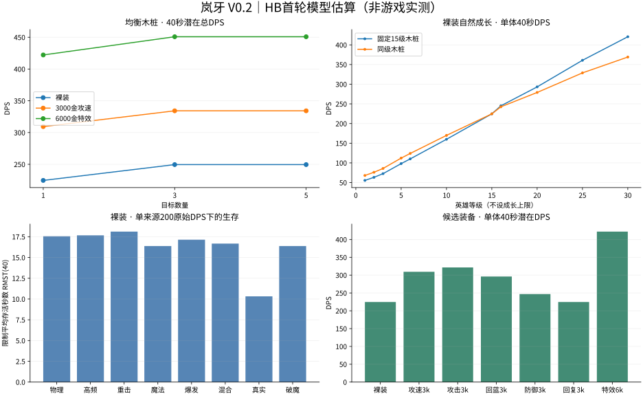

# 岚牙 V0.2 · HB首轮模型测试报告

2026-10-19，R033。用户接受统一方案并要求测试岚牙；本轮保持英雄/装备数值不变。

**这是依照HB场景运行的独立设计模型估算，尚非游戏引擎实测，也不是完整HB合格报告。** 英雄施法/弹道尚未定稿，本报告保留假设和敏感性，不给跨英雄强弱排名。

实际运行 **293组 × 256种子 = 75,008场**。参数与每组统计、配对样本见 [JSON](lanya-benchmark-results.json)，模型见 [脚本](lanya-benchmark.py)，标准见 [HB-1.0](HERO-BENCHMARK.md)。

复现：`python3 docs/heroes/lanya-benchmark.py --run --workers 4`；生成本报告与图：`MPLCONFIGDIR=/tmp/lanya-mpl python3 docs/heroes/lanya-benchmark-report.py`。

## 条件与限制

- 默认15级、4/4/4/3、满血蓝、英雄3号位；目标布局严格使用HB的[3]/[2,3,4]/[1,2,3,4,5]。锁定3号，失效后选最小槽位并保持到失效，3补选邻近目标。
- 主表暂定每技能吟唱占用0.2秒、弹道0.2秒；技能开始付费/启动冷却，完成后获得增益/发射，施法时不能发起普攻；普攻间隔在发射时锁定。此时序是实验假设，不写回英雄。零占用敏感性仍有最多一帧20ms调度延迟。
- 模型使用20ms、独立攻击/各目标技能/各压力源随机流，均值及配对差值仅代表该模型的随机误差。发射命中与附伤共用Q001候选；血潮低血吸血在发射读取，也是未定稿分支。所有附伤不递归、三箭不携带特效。
- 先处理到达弹道，再处理敌方脉冲，再让英雄行动；英雄死亡后不再计在途输出。攻击期间穷追不追溯改变已锁定间隔。跨目标旧弹道不能恢复已经清掉的旧目标层数。
- O1为潜在输出、不产生吸血；O2有限击杀、O3补靶；D1压力源每根行动后恢复生命且不触发击杀，D2敌人可杀。D0关闭回复和全部技能。D1伤害不能当实际击杀输出。
- 不支持正式引擎适配、最终行动时序、全局触发候选的全部分支、正式海克斯、队伍辅助陪测、全装备最优搜索与正式关卡经济。固定属性选择仅为受控假设，不保证随机三选一实际每次刷出该属性。未支持项目不填0。
- JSON是本模型统计格式，未实现HB全部逐事件字段；空指标用null。死亡/清场的条件均值只在部分试验发生事件时可用，正文优先用限制均值和发生率，不能把删失样本当真实事件时间。

## 1. 单体与群体潜在DPS

均衡木桩3000生命/双抗50；以下无敌方反击。每格是全部目标合计，不能把三目标合计当Boss伤害。

| 构筑 | 目标数 | 5秒 | 10秒 | 40秒 | 180秒 |
| --- | ---: | ---: | ---: | ---: | ---: |
| bare | 1 | 368.2 | 350.8 | 224.7 | 161.0 |
| bare | 3 | 434.6 | 384.0 | 249.5 | 166.5 |
| bare | 5 | 434.6 | 384.0 | 249.5 | 166.5 |
| as1500 | 1 | 446.4 | 423.6 | 267.3 | 194.5 |
| as1500 | 3 | 512.7 | 456.8 | 292.2 | 200.0 |
| as1500 | 5 | 512.7 | 456.8 | 292.2 | 200.0 |
| as3000 | 1 | 521.0 | 494.1 | 309.4 | 226.4 |
| as3000 | 3 | 587.3 | 527.3 | 334.2 | 232.0 |
| as3000 | 5 | 587.3 | 527.3 | 334.2 | 232.0 |
| onhit6000 | 1 | 642.2 | 631.5 | 422.2 | 327.2 |
| onhit6000 | 3 | 718.6 | 669.7 | 450.8 | 333.5 |
| onhit6000 | 5 | 718.6 | 669.7 | 450.8 | 333.5 |

三目标和五目标在O1下相同：3技能只打主目标及其最近两个邻位，额外两只不会增加箭数。有限清场则需要额外转火和普攻，结果见下表。

## 2. 各类防御与实际清场

裸装15级。潜在DPS看40秒；清场用180秒观察，限制均值=平均min(清场时间,180)，只有清场率100%时才等于平均实际清场时间。回复桩不做O1。

| 类型 | 单体潜在DPS | 1只清场秒/成功率 | 3只清场秒/成功率 | 5只清场秒/成功率 |
| --- | ---: | ---: | ---: | ---: |
| 零抗 | 315.3 | 5.8 / 100.0% | 21.9 / 100.0% | 46.8 / 100.0% |
| 均衡 | 224.7 | 8.1 / 100.0% | 37.1 / 100.0% | 77.6 / 100.0% |
| 高血 | 224.7 | 21.5 / 100.0% | 97.7 / 100.0% | 179.2 / 28.1% |
| 高护甲 | 178.2 | 9.9 / 100.0% | 54.6 / 100.0% | 109.6 / 100.0% |
| 高魔抗 | 226.5 | 8.7 / 100.0% | 36.8 / 100.0% | 75.8 / 100.0% |
| 双抗 | 152.2 | 12.2 / 100.0% | 67.5 / 100.0% | 132.1 / 100.0% |
| 减伤 | 188.4 | 9.8 / 100.0% | 49.0 / 100.0% | 98.7 / 100.0% |
| 护盾 | 224.7 | 14.6 / 100.0% | 132.5 / 100.0% | 180.0 / 0.0% |
| 闪避 | 177.8 | 10.7 / 100.0% | 53.0 / 100.0% | 106.5 / 100.0% |
| 回复 | — | 9.9 / 100.0% | 69.0 / 100.0% | 142.3 / 100.0% |

护盾潜在总DPS含实际盾伤；高魔抗桩护甲只有30，故岚牙总伤可略高于双抗50的均衡桩，不是魔抗提高伤害。回复只看有限生命测试，不把回复后再次扣血算成虚假伤害。混合木桩的3/5种循环布局与补靶结果均保存在JSON，每布局等样本。

## 3. 承伤

裸装15级、40秒窗口。表中为限制平均存活秒数RMST(40)，未死只算观察到40秒；所有单源格若存活率0%，数值就是平均实际死亡时间。总压为所有来源合计200原始DPS，集火为每个来源200。

| 压力类型 | 静态1源 | 完整技能1源 | 完整技能3源/总压 | 完整技能5源/总压 | 完整技能3源/集火 | 完整技能5源/集火 |
| --- | ---: | ---: | ---: | ---: | ---: | ---: |
| 物理普攻 | 16.8 | 17.6 | 17.9 | 17.8 | 6.0 | 3.7 |
| 高频物理 | 16.3 | 17.7 | 17.8 | 17.8 | 5.9 | 3.7 |
| 重击物理 | 17.3 | 18.1 | 18.1 | 17.7 | 6.2 | 3.8 |
| 持续魔法 | 14.5 | 16.4 | 16.0 | 16.0 | 5.2 | 3.2 |
| 魔法爆发 | 16.3 | 17.1 | 15.4 | 16.0 | 5.8 | 3.5 |
| 物魔混合 | 15.4 | 16.7 | 16.8 | 16.8 | 5.7 | 3.4 |
| 真实 | 9.8 | 10.3 | 10.7 | 10.7 | 3.6 | 2.1 |
| 破魔 | 14.5 | 16.4 | 16.0 | 16.0 | 5.2 | 3.2 |

等总压的不同人数仍有小幅差异：站位影响命中，高频/同步脉冲、回复间隙和最后一击溢出不同。D0/D1差异包含自然回复和3技能闪避，不能全部归功于3。

## 4. 装备增幅与生存

手工候选，不声称最优出装。均遵守4槽；材料价格已含在成品总价中。

| 构筑ID | 装备 | 花费/预算 | 40秒单体DPS | 较裸装 | 每千金增加DPS | 180秒DPS | 混伤D1存活秒RMST(180) |
| --- | --- | ---: | ---: | ---: | ---: | ---: | ---: |
| bare | 无 | 0/0 | 224.7 | 0.0% | — | 161.0 | 16.7 |
| as1500 | 疾风双刃 | 1500/1500 | 267.3 | 19.0% | 28.5 | 194.5 | 16.7 |
| ad1500 | 淬炼长剑＋淬炼长剑 | 1500/1500 | 273.2 | 21.6% | 32.3 | 199.5 | 16.7 |
| as3000 | 疾风双刃＋疾风双刃 | 3000/3000 | 309.4 | 37.7% | 28.2 | 226.4 | 16.7 |
| ad3000 | 淬炼长剑＋淬炼长剑＋淬炼长剑＋淬炼长剑 | 3000/3000 | 321.6 | 43.2% | 32.3 | 238.1 | 16.7 |
| ap3000 | 学徒法杖＋学徒法杖＋储能法杖＋储能法杖 | 3000/3000 | 266.3 | 18.5% | 13.9 | 182.9 | 16.7 |
| mana3000 | 疾风双刃＋回魔宝珠＋咏唱法典 | 3000/3000 | 296.2 | 31.8% | 23.8 | 207.5 | 16.7 |
| def3000 | 守望双刃＋铁甲＋抗魔斗篷＋生命吊坠 | 3000/3000 | 246.8 | 9.9% | 7.4 | 180.1 | 27.1 |
| regen3000 | 复苏护符＋复苏护符＋复苏护符＋复苏护符 | 3000/3000 | 224.7 | 0.0% | 0.0 | 161.0 | 29.4 |
| as6000 | 疾风双刃＋疾风双刃＋疾风双刃＋疾风双刃 | 6000/6000 | 390.1 | 73.6% | 27.6 | 295.6 | 16.7 |
| onhit6000 | 疾风双刃＋连击长弓＋鏖战长枪＋征战长剑 | 6000/6000 | 422.2 | 87.9% | 32.9 | 327.2 | 18.5 |
| sustain6000 | 血潮双刃＋守望双刃＋疾风双刃＋凝神符 | 5700/6000 | 333.1 | 48.3% | 19.0 | 249.1 | 27.4 |

sustain6000实际花5700、余300；其余候选花费恰等预算。AP路线只有1技能吃法强，3不吃；不因路线可选就假定已经等强。生存成绩不含“杀死压力源”的减压。

实际边打边承伤，敌人均衡有限生命、A6合计200原始DPS；40秒死后输出计0。下表用于区分“木桩打得快”与“实际活着打出伤害”。

| 构筑 | 敌人数 | 有效总DPS | 40秒存活率 | 40秒清场率 |
| --- | ---: | ---: | ---: | ---: |
| bare | 1 | 75.0 | 100.0% | 100.0% |
| bare | 3 | 167.6 | 0.0% | 0.0% |
| bare | 5 | 154.6 | 0.0% | 0.0% |
| as3000 | 1 | 75.0 | 100.0% | 100.0% |
| as3000 | 3 | 225.0 | 100.0% | 100.0% |
| as3000 | 5 | 232.3 | 0.0% | 0.0% |
| def3000 | 1 | 75.0 | 100.0% | 100.0% |
| def3000 | 3 | 225.0 | 100.0% | 100.0% |
| def3000 | 5 | 269.1 | 86.7% | 0.0% |
| onhit6000 | 1 | 75.0 | 100.0% | 100.0% |
| onhit6000 | 3 | 225.0 | 100.0% | 100.0% |
| onhit6000 | 5 | 375.0 | 100.0% | 100.0% |

## 5. 自然成长

采用英雄稿主1副2合法点法，15级后固定成长继续、此表额外属性点暂不分配。固定尺为15级木桩；同级尺为H=600+160L、双抗=20+2L。D1同级压力=80+8L。

| 等级 | 技能等级 | 固定尺40秒DPS | 同级尺40秒DPS | 同级混伤RMST(40) |
| --- | --- | ---: | ---: | ---: |
| 1 | 1/0/0/0 | 55.5 | 68.0 | 14.7 |
| 2 | 1/1/0/0 | 63.3 | 76.2 | 14.7 |
| 3 | 2/1/0/0 | 72.6 | 85.8 | 14.7 |
| 5 | 3/1/0/1 | 98.2 | 112.2 | 14.7 |
| 6 | 4/1/0/1 | 110.1 | 124.0 | 14.9 |
| 10 | 4/3/1/2 | 160.0 | 169.9 | 15.5 |
| 15 | 4/4/4/3 | 224.7 | 224.7 | 16.7 |
| 16 | 4/4/4/3 | 245.1 | 242.5 | 16.9 |
| 20 | 4/4/4/3 | 293.2 | 279.0 | 17.4 |
| 25 | 4/4/4/3 | 360.9 | 328.8 | 18.4 |
| 30 | 4/4/4/3 | 420.7 | 369.1 | 19.0 |

额外选择受控对照：16级起每次固定选+8个百分点额外攻速（每次300金工作价），不代表随机升级一定可选到。

| 等级 | 纯自然成长DPS | 加固定攻速选择DPS | 增幅 |
| --- | ---: | ---: | ---: |
| 16 | 245.1 | 247.5 | 1.0% |
| 20 | 293.2 | 334.8 | 14.2% |
| 25 | 360.9 | 475.0 | 31.6% |
| 30 | 420.7 | 611.9 | 45.5% |

## 6. 单技能升满边际

固定15级裸装，基线四技能各1级，未分配点暂存；普通技能多花3点，大招多花2点。配对95%区间是随机采样区间，不覆盖时序假设误差。

| 配置 | 单体40秒DPS | 相对各1级差值[95%区间] | 三目标40秒DPS | 每点单体收益 |
| --- | ---: | --- | ---: | ---: |
| all1 | 159.5 | +0.0 [+0.0, +0.0] | 174.2 | — |
| max1 | 177.5 | +18.0 [+17.8, +18.3] | 192.2 | 6.0 |
| max2 | 190.0 | +30.5 [+29.9, +31.1] | 204.7 | 10.2 |
| max3 | 175.7 | +16.3 [+15.6, +16.9] | 208.9 | 5.4 |
| max4 | 170.3 | +10.8 [+10.7, +10.9] | 185.0 | 5.4 |

## 7. 时序敏感性与强化扰动

每种时序同时改变施法占用与弹道；默认0.2秒。不是已经定稿的英雄动作参数。

| 占用/飞行 | 单体40秒DPS | 三目标40秒DPS |
| --- | ---: | ---: |
| 0秒 | 227.0 | 251.8 |
| 0.2秒 | 224.7 | 249.5 |
| 0.4秒 | 217.3 | 242.2 |

X1为额外攻速+50个百分点，X2为技能急速+30，X3只放大被动真伤/1魔法附伤/连击额外伤害×1.5；不增加普攻或三箭、计数、盾量。这是压力扰动，不是正式海克斯。

| 扰动 | 裸装单体DPS | 6000金特效构筑DPS |
| --- | ---: | ---: |
| none | 224.7 | 422.2 |
| as | 279.1 | 484.0 |
| haste | 226.9 | 427.9 |
| onhit | 269.9 | 500.6 |
| as_onhit | 333.5 | 572.5 |

bare的攻速×附伤交互量：+9.2 DPS；正交互需要纳入预算，不自动判失衡。

onhit6000的攻速×附伤交互量：+10.1 DPS；正交互需要纳入预算，不自动判失衡。

## 8. 自动施法与法力保留

默认策略为4→2→1→3：大招蓝不够就继续检查较便宜的技能，可能长期无法攒到100蓝。补测reserve_r：普通技能支付后，剩余法力加上到大招冷却结束前的自然回蓝，必须够下一次大招；否则暂缓该普通技能。是预先明确的候选策略，不改英雄数值、不声称最优。

| 构筑 | 默认40秒DPS | 留蓝40秒DPS | 默认180秒DPS | 留蓝180秒DPS | 默认/留蓝180秒大招次数 |
| --- | ---: | ---: | ---: | ---: | ---: |
| bare | 224.7 | 211.4 | 161.0 | 194.9 | 1.0/5.0 |
| as3000 | 309.4 | 294.9 | 226.4 | 277.3 | 1.0/5.0 |
| onhit6000 | 422.2 | 405.5 | 327.2 | 388.0 | 1.0/5.0 |

留蓝牺牲部分当下技能，换取后续大招；不能把180秒更优直接当作40秒关卡更优。正式自动策略应结合战斗剩余时长，当前游戏尚未接入此英雄或留蓝策略。

## 首轮判断

- 岚牙在本模型呈现单体持续/开场爆发取向，三箭补少量群伤；3→5目标不增加潜在DPS，有限清场明显变慢。没有证据需要把3扩成五目标。
- 同预算纯攻击力候选略胜纯攻速；加入连击/穷追后特效构筑收益上升。职业方向不等于只能买攻速；目前没有完整装备池搜索或其它英雄对照。
- 防御装木桩DPS低于纯输出装，但在五敌反击中能靠存活提高有效输出；这符合多路线取舍。法强候选明显落后于物理候选，暂不能称为成熟的等强分支。
- 升2的单体边际高于升1；升3的三目标收益突出。需结合早期合法加点和技能职责继续评审，不据此自动改技能数值。
- 180秒默认策略存在低费技能抢蓝，优先明确资源策略再判长期数值强弱；攻击速度与附伤存在正协同，未来海克斯须继续做组合测试。

## 验证与解释边界

- 专项时步与结算检查见 [检查结果](lanya-benchmark-checks.json)，复现 `python3 docs/heroes/lanya-benchmark-check.py`；32种子对比六组20ms/10ms，不把随机区间当模型精度。
- 每场核对生命、法力、承伤分账及伤害来源之和；专项检查覆盖真实吃盾/破魔绕盾、实际生命封顶、三箭目标数、有限死亡、装备槽位/预算与合法加点。
- 各组是同种子配对；JSON提供均值、标准差、P10/P50/P90及均值区间（生存/清场概率使用Wilson区间），并保留关键配对样本。事件未发生用null，存活/清场另有发生率及限制均值。
- 首轮仅岚牙，不能凭这些数字证明比其他英雄强弱。需要后续英雄在相同模型版本和条件下比较，并用实际引擎验证。
- 旧R029简化结果保留；本轮变化来自新布局/动作占用/有限目标/承伤等模型边界，不是英雄技能被暗改。Page待同步；游戏源码未修改。
